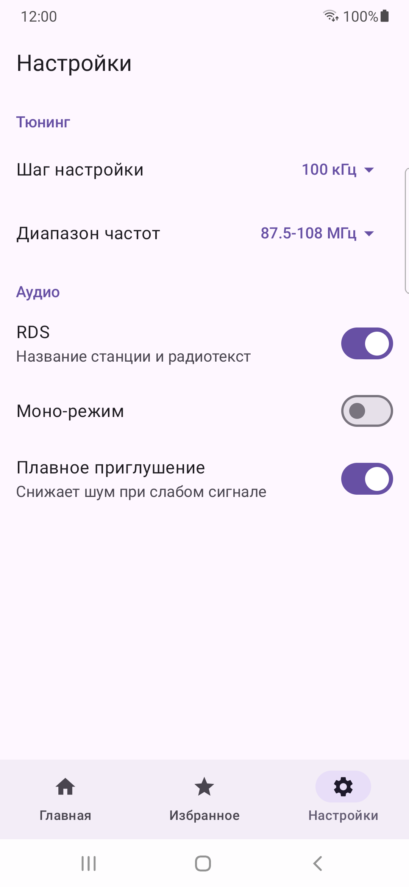
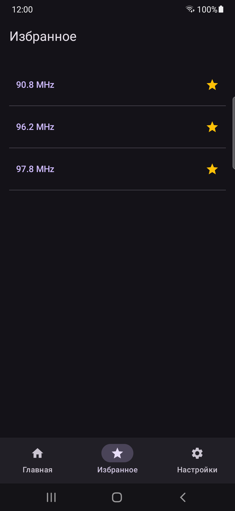
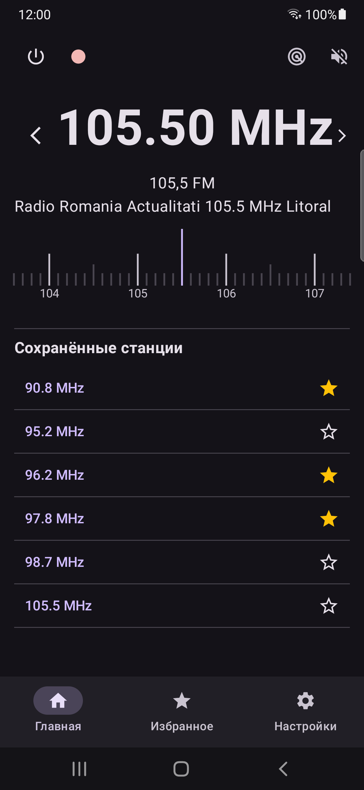

# 📻 Nordis FM Radio

Custom FM radio app for Android, built around hardware FM tuner access on different devices

  
  
  

  
  
  
  
  

## ✨ Features

- Power on/off
- Seek forward / backward
- Frequency scale tuning
- Manual frequency entry via keypad
- Band scan, with results saved to a persisted list (DataStore)
- Favorite stations
- RDS (Radio Data System) PS & RT support
- FM recording (pause / stop / cancel) with automatic volume normalization
- Speaker or headphone output
- Settings: band, channel spacing, RDS, mono mode, soft-mute
- Light and dark theme

## 📱 Supported Devices

Currently supported:

- Samsung Galaxy A10s
- Samsung Galaxy M30s

Other Samsung phones may work, but compatibility is not guaranteed.

Support for additional devices is planned.

## ⚠️ Requirements

- Android 8.0 (API 26) or newer
- A device with FM radio hardware support
- Wired headphones connected (used as the antenna)

## 🌐 Language

The interface is mostly in Russian during the alpha. Translations are planned.

## 📥 Download

Grab the latest APK from the [Releases](https://github.com/NordisApps/nordis_fm_radio/releases) page.

This is an early alpha, so expect bugs and rough edges.

## 🐛 Feedback

Found a bug or have a device to add? Please [open an issue](https://github.com/NordisApps/nordis_fm_radio/issues) and include:

- your phone model and Android version
- what you did and what happened
- what you expected instead

## 📝 License
 
Licensed under the [GNU General Public License v3.0](LICENSE).

## 👤 Author
 
Built by Nordis.
